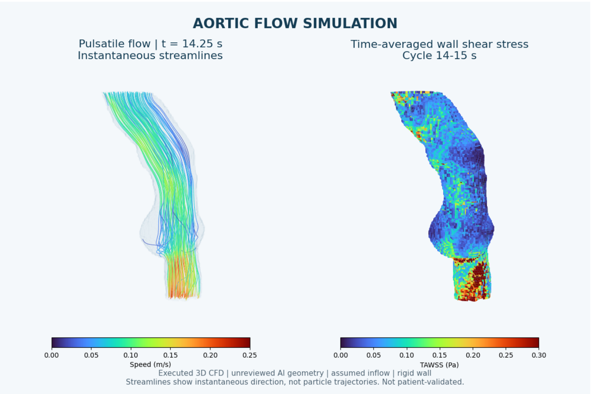
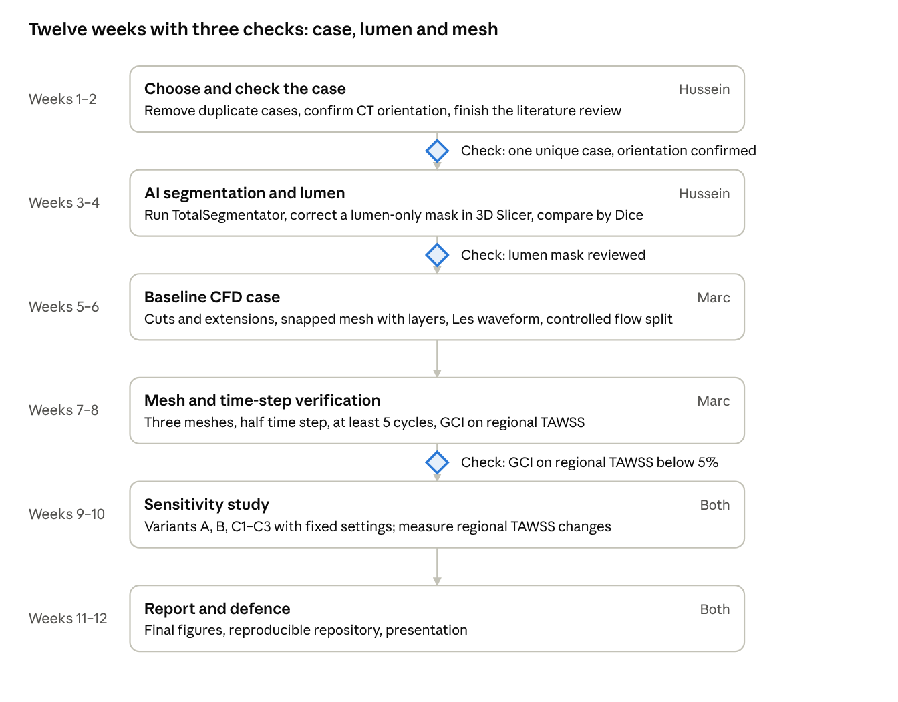

# Aortic Aneurysm Project: State of the Art and Proposed Methodology

Hussein and Marc, MSc Advanced Mechatronics, Polytech Annecy-Chambéry · Supervisor: Manuel Lagache · 4 November 2026

## 1. Aim and research question

We chose the numerical and AI track: build a 3D aorta from CT with AI segmentation, simulate pulsatile blood flow, and compute wall shear stress (WSS) and its time average (TAWSS).

**Why it matters.** Surgeons decide on aneurysm repair mainly from the maximum diameter. Flow-based parameters such as TAWSS and the oscillatory shear index (OSI) may add information on growth and thrombus, but the evidence is not settled (section 3).

**Our research question.** How much do the segmentation and surface-smoothing choices used to build the aorta change the regional TAWSS that CFD predicts?

This question matters for every flow-based predictor: if a small change in the reconstructed wall moves TAWSS more than the difference between patients, the predictor is not usable. It is also realistic for one semester, because it needs one well-checked case, not a clinical cohort.

**What this document contains**, following the supervisor's request: a review of each source (objective and method, data type, how the data were obtained and processed, use for us, what we can reproduce), what the review means for our method, the findings of a first data check and pilot simulation, and the proposed methodology and plan.

$$\mathrm{TAWSS}=\frac{1}{T}\int_0^T |\boldsymbol{\tau}_w(t)|\,dt \qquad \mathrm{OSI}=\frac{1}{2}\left(1-\frac{\left|\int_0^T \boldsymbol{\tau}_w\,dt\right|}{\int_0^T |\boldsymbol{\tau}_w|\,dt}\right) \qquad \mathrm{RRT}=\frac{1}{(1-2\,\mathrm{OSI})\,\mathrm{TAWSS}}$$

Here τ_w is the wall shear stress vector over one cardiac cycle of length T. TAWSS is in Pa, OSI ranges from 0 (shear never reverses) to 0.5 (fully oscillating), and RRT (relative residence time, Pa⁻¹) highlights where blood lingers.

## 2. State of the art: datasets

Only two of the datasets on the supervisor's list contain aneurysms (AortaSeg-60 and the abdominal CTA set); the others are dissection, mostly healthy or synthetic aortas, useful for training segmentation and testing the CFD chain. Sorted from most to least useful for our question. "Read" says how much of each source we checked.

| Source | Objective and method | Data type | How the data were obtained and processed | Use for our project | What we can reproduce or adapt |
| --- | --- | --- | --- | --- | --- |
| [AortaSeg-60](https://www.preprints.org/manuscript/202605.1002) (El Rahal, Rotzinger, Fahrni, 2026) | Open real-world aortic CT set with automatic masks, for AI benchmarking and studying typical segmentation errors | 60 thoraco-abdominal CT scans in 6 groups of 10: young normal, elderly normal, aneurysm, dissection, venous phase, non-contrast | One hospital, 2014–2024. Masks made by TotalSegmentator v2.12 (aorta task) with no manual correction and no resampling | Our pilot case (Anev_01). Directly suited to our question because the masks are uncorrected | Compare our own segmentation and corrections with the raw masks. Read: preprint and dataset page |
| Abdominal aorta CTA dataset ([Kodenko et al., 2025](https://journal-vniispk.ru/DD/article/view/310049)) | Open CTA set with abdominal aorta segmentation, for AI training | 100 CTA studies; about 18 with dilation and 18 with thrombosed lumen (groups overlap) | Semi-automatic segmentation in 3D Slicer with expert checks; NIfTI format | Best source of expert-checked aneurysm masks, abdominal only | The Slicer workflow; separate lumen from thrombus labels. Read: abstract only; access terms unconfirmed |
| [AVT](https://www.ncbi.nlm.nih.gov/pmc/articles/PMC8760499/) (Radl et al., 2022, Data in Brief) | Multicentre aortic vessel tree masks, for shape models and segmentation benchmarks | 56 CTAs from the ascending aorta to the iliac arteries; mostly healthy, 1 abdominal aneurysm, 5 dissections | Three source collections at different resolutions. Semi-automatic masks in 3D Slicer plus manual cleanup | Reference-quality masks to measure segmentation accuracy (Dice) and branch handling | Train or test a segmentation model; reuse the Slicer cleanup steps. Read: full article |
| [Mayer et al., 2024](https://www.ncbi.nlm.nih.gov/pmc/articles/PMC11156948/) (Scientific Data); PMC11156948 is the same paper | Expert true/false lumen annotations for type B dissection AI | 40 CTAs, NRRD images and masks, STL surfaces | Routine CTAs 2005–2021. 3D Slicer (Grow Cut, interpolation) plus 2–3 h manual cleanup per case. Mean slice thickness 2.56 mm | Ready-made STL surfaces to test meshing early; dissection, not aneurysm | Their NRRD-to-STL code. Read: abstract, data descriptor and dataset page |
| [ImageTBAD](https://ar5iv.labs.arxiv.org/html/2109.00374) (Yao et al., 2021, Frontiers in Physiology); PMC8503642 is this paper | Segmentation benchmark for type B dissection | 100 CTAs (68 with false lumen thrombus); labels: true lumen, false lumen, false lumen thrombus | One hospital, January 2013 to April 2015; Siemens and Philips scanners, 0.75 mm spacing. One radiologist labelled, a second checked (1–1.5 h per case) | Shows thrombus is the hardest class: their 3D U-Net reached Dice 0.86 for true lumen but only about 0.5 for thrombus | Label thrombus separately from the flow lumen. Read: full article |
| [AortaSeg24](https://arxiv.org/abs/2502.05330) (Imran et al., 2025) | Challenge for multi-class segmentation of aortic branches and zones | 100 CTAs with 23 classes; 50 released for training | Expert annotations; access by data-use agreement | Benchmark if we need named branches and zones | The organisers' label definitions. Read: abstract and access pages |
| [SynthAorta](https://repository.tugraz.at/records/f31ph-37h03) (Bosnjak et al., 2025) | Parametrised healthy aortas for simulation and uncertainty studies | 30,000 synthetic aortas with 3 supra-aortic vessels; hexahedral meshes at 4 levels | Generated from parameters, not from CT. MATLAB tools export .msh | Controlled shape variants to test the solver; no pathology | A mesh-refinement series on a known geometry. Read: repository page |
| [Open cardiovascular datasets catalogue](https://github.com/gfahrni/open-cardiovasc-imaging-datasets) | A finder, not a paper: 39 open datasets, 4 aortic | – | – | Where to look for more aneurysm data | – |

The TU Graz record ft6av-k4w55 on the list points to the same SynthAorta data, and the two figshare links are the dataset pages of AVT and Mayer.

## 3. State of the art: methods and clinical evidence

The strongest clinical study so far links low baseline shear stress (below 0.4 Pa) to faster aneurysm growth and more ruptures or repairs, but every study builds its CFD differently, and none tests how much the reconstruction itself moves TAWSS.

### 3.1 Methods: from CT to WSS

| Source | Objective and method | Data type | How the data were obtained and processed | Use for our project | What we can reproduce or adapt |
| --- | --- | --- | --- | --- | --- |
| [TotalSegmentator](https://pmc.ncbi.nlm.nih.gov/articles/PMC10546353/) (Wasserthal et al., 2023, Radiology: AI) | nnU-Net model segmenting 104 structures in CT, including the aorta | 1,204 routine CT exams | Resampled to 1.5 mm; public model and pip package | Our AI segmentation baseline; it made the AortaSeg-60 masks | Run the aorta task ourselves on the pilot CT. Read: abstract and README |
| [Du et al., 2025](https://arxiv.org/html/2503.12515v1) (arXiv preprint) | Deep learning that joins voxel segmentation with surface deformation to give CFD-ready meshes | 32 VMR and 16 AVT cases | Segmentation, then graph-based surface refinement | Closest match to our segmentation-to-mesh step | Their geometry-quality checks beyond Dice. Read: full text |
| [Maher et al., 2020](https://arxiv.org/html/2009.07395v1) (arXiv; journal version 2021) | Dropout segmentation network produces many plausible geometries; flow is simulated on each | 3 cardiovascular models, including an abdominal aneurysm | Image-derived geometry samples feed CFD | Direct scientific basis for our question: geometry uncertainty changes WSS | Our deterministic version: fixed smoothing levels. Read: abstract |
| [Lv et al., 2022](https://academic.oup.com/ehjdh/article/3/4/525/6760872) (Eur Heart J Digital Health) | AI segments the ascending aorta, then a PointNet network predicts TAWSS trained on CFD | 154 patients (139 train, 15 test) | Segmentation Dice 0.86; TAWSS error about 7.9% | The only published AI-plus-CFD-plus-TAWSS chain on our list | Long-term idea: a TAWSS surrogate, only once CFD labels are reliable. Read: full text |
| [Aycan, Topuz and Kadem, 2023](https://arxiv.org/abs/2309.05509) (arXiv) | Grid convergence index (GCI) for aortic CFD with WSS as the monitored output | Healthy, fusiform and saccular aortic geometries | Several mesh types and resolutions | How to prove our WSS is mesh-independent | GCI on three meshes. Read: abstract |
| [Les et al., 2010](https://stanfordhealthcare.org/publications/896/89655.html) (Ann Biomed Eng) | Patient-specific CFD of abdominal aneurysms with MRI-measured flow, rest versus exercise | 8 AAA patients; MRI geometry, flows and pressures | Meshes of 5.7–12 million elements | A measured source for our inflow waveform; mean WSS in the aneurysm at rest was only 0.25 Pa | Use their infrarenal flow data for our inlet. Read: abstract |

### 3.2 Clinical evidence: does WSS predict growth or rupture?

| Source | Patients and data | CFD approach | Main finding | What it means for us |
| --- | --- | --- | --- | --- |
| [Bappoo et al., 2021](https://discovery.dundee.ac.uk/en/publications/low-shear-stress-at-baseline-predicts-expansion-and-aneurysm-rela/) (Circ Cardiovasc Imaging) | 295 AAA patients, baseline CTA, ultrasound every 6 months, median follow-up 914 days | Automated CFD on CTA models | Low shear (<0.4 Pa): event rate 44% versus 27–29%; adjusted HR 1.72 (95% CI 1.08–2.73); expansion +0.28 mm/year | Strongest evidence that TAWSS adds to diameter. Authors call for larger validation first |
| [Zambrano et al., 2016](https://link.springer.com/10.1007/s10439-015-1461-x) (Ann Biomed Eng) | 14 patients, longitudinal CT | CFD WSS compared with thrombus growth | Thrombus builds where WSS is low; aneurysms with thrombus had lower WSS and grew faster | Thrombus and low WSS are linked, so our lumen must exclude thrombus |
| [Moon et al., 2025](https://www.frontiersin.org/journals/cardiovascular-medicine/articles/10.3389/fcvm.2025.1633938/full) (Front Cardiovasc Med) | 4 ruptured AAAs | SimVascular, generic waveform (about 5.4 L/min), RCR outlets, rigid walls, no mesh study | Rupture sites had lower TAWSS and higher OSI; in 2 cases rupture was away from the maximum diameter | Example setup we can copy; also shows typical gaps (no mesh study) |
| [Mutlu et al., 2026](https://pmc.ncbi.nlm.nih.gov/articles/PMC13003724/) (Int J Numer Meth Biomed Eng) | 22 ruptured or impending-rupture AAAs, 1 healthy | ANSYS CFX, lumen only, inflation layers, GCI below 2%, Carreau blood, literature waveforms | About 91% of rupture sites had TAWSS 0–0.5 Pa and OSI 0.35–0.5 | Good model of mesh verification; no intact control group |
| [Indrakusuma et al., 2016](https://read.qxmd.com/read/27558090/biomechanical-imaging-markers-as-predictors-of-abdominal-aortic-aneurysm-growth-or-rupture-a-systematic-review) (systematic review) | 27 studies, 1,730 patients | Mostly wall stress (FEA), some CFD | Peak wall stress higher in ruptured AAAs in 10 of 13 studies; results on growth conflict | Evidence is promising but not standardised |

**What the evidence says.** Low TAWSS (about 0.4–0.5 Pa and below) and high OSI recur across studies at growing, thrombus-forming or rupturing sites. But inflow, outlets, blood model, mesh and geometry differ in each study, and many skip mesh checks. If TAWSS thresholds are to guide surgery, the TAWSS value must not depend on how the aorta was segmented and smoothed. That is the gap our project tests.

## 4. What the review means for our methodology

The review points to an abdominal aneurysm case, a lumen-only geometry, literature flow conditions and a proper mesh study.

| Choice | Decision | Reason from the review |
| --- | --- | --- |
| Region | Abdominal aorta (infrarenal aneurysm to iliac bifurcation), unless the supervisor prefers thoracic | The clinical evidence (Bappoo, Zambrano, Moon, Mutlu) and the aneurysm datasets are mostly abdominal |
| Pilot data | AortaSeg-60 aneurysm group, starting with Anev_01 | Real aneurysms with uncorrected AI masks: ideal for measuring segmentation effects |
| Reference masks | AVT for healthy reference; Kodenko set for expert aneurysm masks if access is granted | AortaSeg-60 masks are not expert-checked |
| Geometry | Blood lumen only; thrombus labelled separately | Thrombus forms where WSS is low (Zambrano); ImageTBAD shows thrombus is hard to segment |
| AI segmentation | TotalSegmentator as the baseline; compare with corrected masks by Dice and surface distance | Already the tool behind AortaSeg-60; public and runs on CPU |
| Flow conditions | Measured infrarenal waveform from the literature (Les et al.); controlled outlet flow split (Windkessel if the solver allows) | No dataset supplies patient flow; Moon and Mutlu use the same approach |
| Mesh | Snapped mesh with wall layers; three refinement levels with GCI on TAWSS | WSS depends on the near-wall gradient (Aycan; Mutlu reached GCI < 2%) |
| Outputs | TAWSS, OSI, RRT maps; area-weighted regional means; area below 0.4 Pa | The 0.4 Pa threshold from Bappoo is the most tested clinical value |

**Gaps the review leaves open:** no patient-specific flow data for any public case, no thoracic aneurysm dataset with expert masks, and no outcome data (growth or rupture) for the public cases. Our conclusions will therefore concern how robust TAWSS is, not individual rupture risk.

## 5. Data check on the pilot case (AortaSeg-60, Anev_01)

Before any simulation we checked the pilot CT and its mask, and found four problems that must be solved before the geometry can be trusted.

| Finding | What we measured | Consequence |
| --- | --- | --- |
| CT and mask do not line up | Same grid (512 × 512 × 1086 voxels, 0.773 × 0.773 × 0.6 mm), but z origins differ by about 651 mm. Reversing the CT slice order gives a much closer overlay | Likely a metadata error; a hypothesis until confirmed with the dataset authors or acquisition data |
| Duplicate cases | The Anev_03 and Anev_05 masks are byte-identical (same SHA-256). Other files share size and checksum (03/05/08/10 and 04/07), not yet hashed | The aneurysm group may hold fewer than 10 different patients |
| Mask probably includes thrombus | In the overlay the mask outline is wider than the bright contrast-filled lumen | CFD on this surface would put the wall at the outer aneurysm wall, not where blood flows |
| Smoothing changes the surface, not the volume | Smoothing 0, 10 or 30 iterations: volume changes only +0.5% (671.4 → 674.7 mL), but surface area falls 18% (97,229 → 79,915 mm²) and the wall moves up to 0.67 mm (95th percentile) | Volume or Dice alone cannot show whether a geometry is good enough for WSS |

The raw mask has 7 connected pieces; the largest holds 99.99% of the voxels and its surface is closed (no open or non-manifold edges). Part of the area drop is the removal of voxel staircase steps, which is exactly why the smoothing level must be a controlled variable in our study.

In a second test the mask was "repaired" automatically (closing, hole filling, smoothing). This changed 20.5% of the voxels, increased the volume by 14% and moved the boundary by up to 10 mm. We do not use it as a reference: an automatic repair that large changes the anatomy we want to study.

## 6. Pilot feasibility test

The full chain from CT mask to TAWSS map runs end to end, but the pilot results are not yet reliable enough to interpret: local TAWSS changes by more than 50% between two meshes.

**Step 1: verify the WSS calculation on a pipe.** We solved pulsatile flow in a straight pipe (radius 10 mm, period 1 s) and compared it with the exact Womersley solution. WSS error fell from 0.27% to 0.019% as the radial grid went from 40 to 160 cells, so the TAWSS, OSI and RRT code is correct. This checks the method, not aneurysm flow.

**Step 2: simulate one aneurysm.** We cut a 180 mm segment of the Anev_01 mask (smoothed 10 iterations) from the lower abdominal aorta to the iliac arteries, with one inlet and two outlets.

| Setting | Pilot value | Why it must change |
| --- | --- | --- |
| Solver | OpenFOAM v1912, pimpleFoam, laminar | – |
| Blood | Newtonian, 1060 kg/m³, 0.0035 Pa·s | Acceptable baseline |
| Wall | Rigid, no slip | Acceptable baseline |
| Inlet | Invented sine wave, 50 ± 35 mL/s, flat profile | Not physiological; no backflow |
| Outlets | Zero pressure at both | Flow split is not controlled |
| Mesh | 12,318 and 41,540 cells; wall layers on only 1.4% of the wall | Far too coarse near the wall |
| Run | 15 cycles, last cycle analysed; cycle-to-cycle TAWSS change 0.002% | Periodic: this part is fine |

**What the pilot shows.** Mean TAWSS is very low (0.07 Pa) because the invented inflow is low; a pipe estimate at the same flow gives the same order. The aneurysm sac has the lowest TAWSS, as in the literature. Mass is conserved to 7 × 10⁻⁷ %.

**Why we cannot use the numbers yet.** The whole-wall mean TAWSS differs by only 0.003% between the two meshes, but regional means in 30 mm bands differ by 1–11%, and the local maps differ by 54–57% (relative L2). A stable average hides an unconverged map. The geometry also probably includes thrombus (section 5).

A second test run (128,472 cells, automatically repaired mask, 3 cycles) gave the same lesson: its WSS still changed 8.9% between cycles 2 and 3, above our 5% limit, and its staircase wall produced local spikes up to 11.8 Pa. We keep it only as a record in the repository.

## 7. Proposed methodology

We will build one carefully checked aneurysm case, prove its TAWSS is mesh-independent, then change only the segmentation or smoothing and measure how much regional TAWSS moves.

1. **Choose and check the case.** Hash every AortaSeg-60 aneurysm file to remove duplicates. Confirm the CT orientation (dataset authors or anatomical landmarks). Keep Anev_01 if it passes; otherwise use another unique case.
2. **Segment with AI.** Run TotalSegmentator (aorta task) on the CT ourselves and record the version. Compare with the dataset mask (Dice, surface distance).
3. **Make a lumen-only reference.** Correct the mask in 3D Slicer so it holds only the contrast-filled lumen; label thrombus separately. Save the edit log and have the result reviewed (supervisor or a clinician).
4. **Build the CFD geometry.** Smooth, cut the inlet below the renal arteries and the outlets on both iliac arteries perpendicular to the centreline, and add straight flow extensions (3 diameters at the inlet, 5 at the outlets).
5. **Mesh.** snappyHexMesh with snapping on and 5 prism layers on the wall; three meshes refined by a factor of about 1.5 in each direction. A first test on the pilot surface showed why smoothing matters: layers covered only about 6% of the wall thickness target on the voxel-stepped surface, and 56% after 30 extra smoothing iterations that moved the wall by 0.25 mm (95th percentile). The smoothing needed just to mesh changes the geometry, which is exactly what our study measures.
6. **Set the physics.** Newtonian blood (1060 kg/m³, 0.0035 Pa·s), rigid walls, laminar. Inlet: measured infrarenal waveform from Les et al. (2010), entering as a flat profile that develops along the inlet extension. Outlets: the flow split set explicitly (Murray's law, flow proportional to diameter cubed) at one iliac outlet and zero reference pressure at the other. A three-element Windkessel is the better option but needs a compiled OpenFOAM build or SimVascular; the Ubuntu OpenFOAM package cannot compile custom boundary conditions.
7. **Solve and check.** Run at least 5 cycles; accept when phase-by-phase WSS changes less than 1–2% between the last two cycles and mass imbalance is below 0.5%. Repeat with half the time step.
8. **Post-process.** Export TAWSS, OSI and RRT on the wall only. Our WSS calculation reproduces the exact Poiseuille pipe value within 0.6%. Report area-weighted means in fixed anatomical regions (neck, sac, iliac outlets) and the wall area below 0.4 Pa.
9. **Mesh verification.** Grid convergence index on regional TAWSS across the three meshes; target below 5%.
10. **Sensitivity study (our research question).** Keep the mesh settings and boundary conditions fixed and change one thing at a time:

| Variant | What changes | What we measure |
| --- | --- | --- |
| A | Reviewed lumen (reference) | Baseline TAWSS, OSI, area < 0.4 Pa |
| B | Raw TotalSegmentator mask (may include thrombus) | Dice and surface distance to A; change in regional TAWSS |
| C1, C2, C3 | Reference smoothed at 0, 10 and 30 iterations | Wall displacement, area, volume; change in regional TAWSS |
| D (optional) | Inflow amplitude ±20% | Whether geometry effects are larger than flow-condition effects |

The result is a simple, defensible statement such as "smoothing that moves the wall by 0.7 mm changes sac TAWSS by X%", compared with the mesh error from step 9. If time allows, we repeat it on two or three more cases.

The scripts for each step are in this repository: `data_prep/` (steps 1–3) and `cfd_v2/` (steps 4–9).

## 8. Semester plan and team split

The plan runs in six two-week phases; week numbers shift to the real course calendar once the deadline is known.

Work does not move to the next phase until its check passes, so a bad case or an unconverged mesh is caught before the study depends on it.

**Team split.** Hussein: datasets, literature review, segmentation and geometry. Marc: CFD setup, boundary conditions, mesh and time-step checks, WSS export. Both: choice of region, interpretation and presentation. We agree on units (metres in CFD, millimetres in Slicer), patch names and file formats before exchanging meshes.

**Risks and fallbacks.**

- CT orientation cannot be confirmed: switch to another unique AortaSeg-60 aneurysm or the Kodenko set.
- No one can review the lumen: report the study as a reconstruction-sensitivity study and say so clearly.
- Not enough computing time: finish one fully verified case rather than many unverified variants.
- Mesh does not converge: refine near the wall first, since that is where WSS is computed.

## 9. Questions for the supervisor

- [ ] Abdominal or thoracic aneurysms? Our proposal assumes abdominal, where the data and clinical evidence are.
- [ ] How much AI work do you expect: running a pretrained model (TotalSegmentator) is enough, or should we train or fine-tune one?
- [ ] Is there any flow data (4D flow MRI, Doppler) or local aneurysm CT data we could use?
- [ ] Can someone review our lumen segmentation (you, or a radiologist contact)?
- [ ] Which CFD software and computer can we use (OpenFOAM on our laptops, Fluent or a university cluster)?
- [ ] What is the final deliverable and deadline: report, code repository, presentation, or all three?

## 10. References

**Datasets**

1. El Rahal D, Rotzinger DC, Fahrni G. [AortaSeg-60: an open real-world CT-angiography dataset of the aorta with automated segmentation masks](https://www.preprints.org/manuscript/202605.1002). Preprints.org, 2026. Data: Zenodo 10.5281/zenodo.18147026.
2. Kodenko MR et al. [CT angiography dataset with abdominal aorta segmentation](https://journal-vniispk.ru/DD/article/view/310049). Digital Diagnostics, 2025.
3. Radl L et al. [AVT: multicenter aortic vessel tree CTA dataset collection with ground truth segmentation masks](https://www.ncbi.nlm.nih.gov/pmc/articles/PMC8760499/). Data in Brief, 2022. Data: [figshare 14806362](https://figshare.com/articles/dataset/Aortic_Vessel_Tree_AVT_CTA_Datasets_and_Segmentations/14806362).
4. Mayer C et al. [Type B aortic dissection CTA collection with true and false lumen expert annotations](https://www.ncbi.nlm.nih.gov/pmc/articles/PMC11156948/). Scientific Data, 2024. Data: [figshare 22269091](https://figshare.com/articles/dataset/Aortic_Dissection_Dataset_and_Segmentations/22269091).
5. Yao Z et al. [ImageTBAD: a 3D CTA image dataset for automatic segmentation of type-B aortic dissection](https://ar5iv.labs.arxiv.org/html/2109.00374). Frontiers in Physiology, 2021 ([PMC8503642](https://pmc.ncbi.nlm.nih.gov/articles/PMC8503642)).
6. Imran M et al. [Multi-class segmentation of aortic branches and zones in CTA: the AortaSeg24 challenge](https://arxiv.org/abs/2502.05330). arXiv, 2025.
7. Bosnjak D et al. [SynthAorta dataset](https://repository.tugraz.at/records/f31ph-37h03). TU Graz, 2025. Code: [GitHub](https://github.com/domagoj-bosnjak/SynthAorta).
8. Fahrni G. [Open cardiovascular imaging datasets catalogue](https://github.com/gfahrni/open-cardiovasc-imaging-datasets). GitHub.

**Methods**

9. Wasserthal J et al. [TotalSegmentator: robust segmentation of 104 anatomic structures in CT images](https://pmc.ncbi.nlm.nih.gov/articles/PMC10546353/). Radiology: Artificial Intelligence, 2023.
10. Du et al. [AI-powered automated model construction for patient-specific CFD simulations of aortic flows](https://arxiv.org/html/2503.12515v1). arXiv, 2025.
11. Maher G, Fleeter C, Schiavazzi D, Marsden A. [Geometric uncertainty in patient-specific cardiovascular modeling with convolutional dropout networks](https://arxiv.org/html/2009.07395v1). arXiv, 2020.
12. Lv et al. [An AI-based platform for automatically estimating time-averaged wall shear stress in the ascending aorta](https://academic.oup.com/ehjdh/article/3/4/525/6760872). European Heart Journal Digital Health, 2022.
13. Aycan O, Topuz A, Kadem L. [Evaluating uncertainties in CFD simulations of patient-specific aorta models using grid convergence index](https://arxiv.org/abs/2309.05509). arXiv, 2023.
14. Les AS, Shadden SC, Figueroa CA, et al. [Quantification of hemodynamics in abdominal aortic aneurysms during rest and exercise using MRI and CFD](https://stanfordhealthcare.org/publications/896/89655.html). Annals of Biomedical Engineering, 2010; 38(4):1288–1313.
15. Womersley JR. [Method for the calculation of velocity, rate of flow and viscous drag in arteries when the pressure gradient is known](https://doi.org/10.1113/jphysiol.1955.sp005276). Journal of Physiology, 1955.

**Clinical evidence**

16. Bappoo N, Syed MBJ, Khinsoe G, et al. [Low shear stress at baseline predicts expansion and aneurysm-related events in patients with abdominal aortic aneurysm](https://discovery.dundee.ac.uk/en/publications/low-shear-stress-at-baseline-predicts-expansion-and-aneurysm-rela/). Circulation: Cardiovascular Imaging, 2021; 14(12):1112–1121.
17. Zambrano BA, Gharahi H, Lim C, et al. [Association of intraluminal thrombus, hemodynamic forces, and abdominal aortic aneurysm expansion using longitudinal CT images](https://link.springer.com/10.1007/s10439-015-1461-x). Annals of Biomedical Engineering, 2016; 44:1502–1514.
18. Moon K et al. [Hemodynamic predictors of rupture in abdominal aortic aneurysms: a case series using CFD](https://www.frontiersin.org/journals/cardiovascular-medicine/articles/10.3389/fcvm.2025.1633938/full). Frontiers in Cardiovascular Medicine, 2025.
19. Mutlu O et al. [Integrated assessment of wall shear stress-related hemodynamic parameters in abdominal aortic aneurysms: ruptured cases](https://pmc.ncbi.nlm.nih.gov/articles/PMC13003724/). Int J Numer Meth Biomed Eng, 2026; 42(3):e70153.
20. Indrakusuma R et al. [Biomechanical imaging markers as predictors of abdominal aortic aneurysm growth or rupture: a systematic review](https://read.qxmd.com/read/27558090/biomechanical-imaging-markers-as-predictors-of-abdominal-aortic-aneurysm-growth-or-rupture-a-systematic-review). Eur J Vasc Endovasc Surg, 2016.
